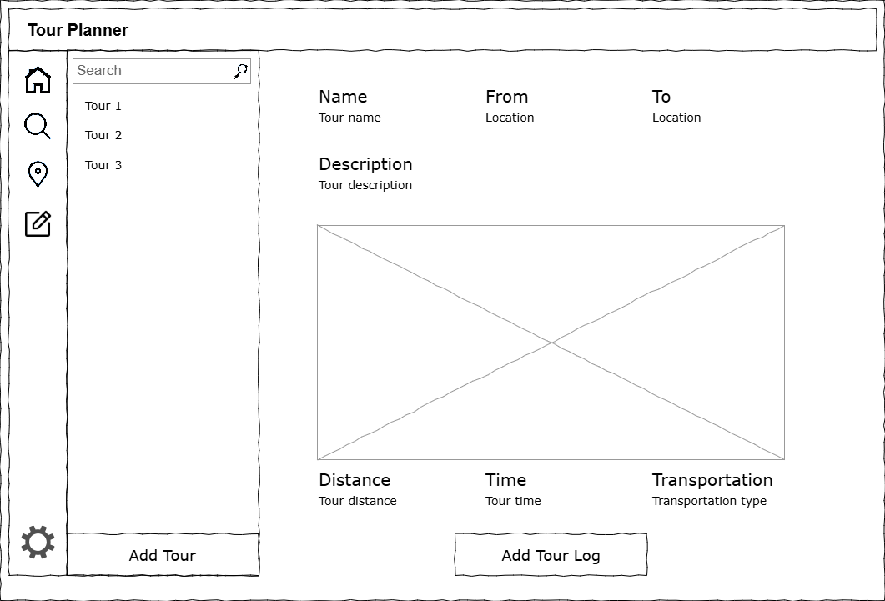
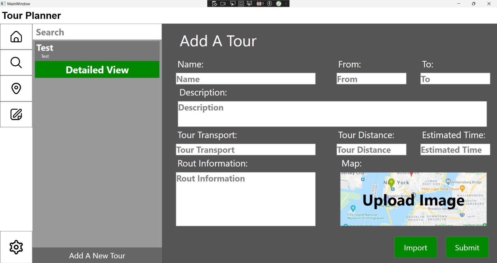

# SWEN TourPlanner
Emre Akyol & Harmanpreet Chauhan - https://github.com/AkyolEmre/TourPlannerSwenAC

## **Application Overview**

**Tour Planner** is a desktop-based application developed using **C#** and the **Windows Presentation Foundation (WPF)** framework. It provides a comprehensive solution for planning, organizing, and tracking outdoor tours, including **biking**, **hiking**, **running**, and **vacation** activities.

The application enables users to create and maintain a catalog of tours, manage detailed logs for each activity, and analyze performance through integrated statistical views. With an intuitive and user-centered design, Tour Planner enhances the efficiency of tour management by streamlining the creation, modification, and tracking of tour-related data.

------

## **Application Design**

### **User Experience (UX) and Interface Layout**

The interface is organized into a **three-column layout**, providing a clean and structured workflow. Each panel plays a specific role in supporting seamless navigation and interaction.

------

### **1. Navigation Panel (Left Sidebar)**

- **Purpose:** Serves as the main navigation area of the application.
- **Design:** A vertical toolbar positioned on the far left of the screen.
- **Components:**
  - Icon-based buttons representing different application views or features, such as:
    - Dashboard (Home)
    - Tour Overview
    - Statistics
    - Settings
  - Visual feedback for selected icons (highlighting or active state)
- **Behavior:**
   Selecting an icon updates the content displayed in the center and right panels accordingly, without navigating away from the main window.

------

### **2. Tour List Panel (Middle Section)**

- **Purpose:** Displays all existing tours in a scrollable list.
- **Design:**
  - Vertically stacked entries, each showing:
    - Tour title
    - Type (bike, hike, etc.)
    - Date or duration
    - Small preview or status indicators (e.g., completed, planned)
  - Search and filter functionality to quickly locate specific tours
- **Behavior:**
  - Clicking on a tour item updates the details panel on the right.
  - The panel supports sorting (e.g., by date, name, type) and dynamic updates when new tours are created or modified.

------

### **3. Details Panel (Right Section)**

- **Purpose:** Acts as the primary workspace for interacting with tour details and logs.
- **Design:**
  - The largest panel on the screen to provide sufficient space for rich content
  - Uses a tabbed or segmented layout to separate:
    - **Tour Overview:** Name, type, description, estimated time, distance, route preview
    - **Tour Logs:** Date of completion, user notes, weather, difficulty, time taken, and personal performance
    - **Statistics:** Aggregated data such as total distance traveled, elevation gain, average duration, and comparisons between tours
- **Behavior:**
  - Content updates dynamically based on the selected tour
  - Real-time reflections of any changes made in the tour or logs
  - Interactive elements such as charts or maps for visualizing performance

------

### **Interaction Flow**

- **Creating a Tour:**
  1. User clicks the “New Tour” button.
  2. A form dialog appears, prompting the user to input relevant details: name, type, route description, distance, estimated time, etc.
  3. Upon submission, the new tour is added to the Tour List and becomes available for detailed viewing.
- **Adding a Tour Log:**
  1. User selects a tour from the Tour List.
  2. Within the Tour Details panel, the user clicks “Add Log.”
  3. A form opens to capture data like actual duration, user notes, weather conditions, and perceived difficulty.
  4. Submitted logs are listed and visualized under the “Logs” tab for that tour.

------

### **Technical Highlights**

- **Framework:** C# with WPF (MVVM design pattern)
- **Data Binding:** Strong use of WPF data binding for dynamic UI updates
- **Forms & Validation:** Custom form controls with input validation for reliable data entry
- **Responsive UI:** Adaptive layout scaling for different screen resolutions
- **Persistence:** Back-end integration with local storage or cloud options (depending on deployment)

Mockup             |  Implementation
:-------------------------:|:-------------------------:
|       |  |

## Implementation

### **Library Decisions**

#### **Object-Relational Mapper (O/R Mapper): Dapper**

- **Reason for Selection:**
   Dapper is a lightweight and high-performance micro-ORM that simplifies database access while maintaining full control over SQL queries. It is easy to use, well-supported, and widely adopted in the .NET ecosystem.
- **Benefits:**
  - Fast and efficient for read/write operations
  - Minimal setup and low overhead
  - Strongly-typed mapping to C# objects
  - Ideal for applications with straightforward data access needs
- **Application Use:**
   Used for executing parameterized queries and mapping results to domain models such as `Tour` and `TourLog`.
